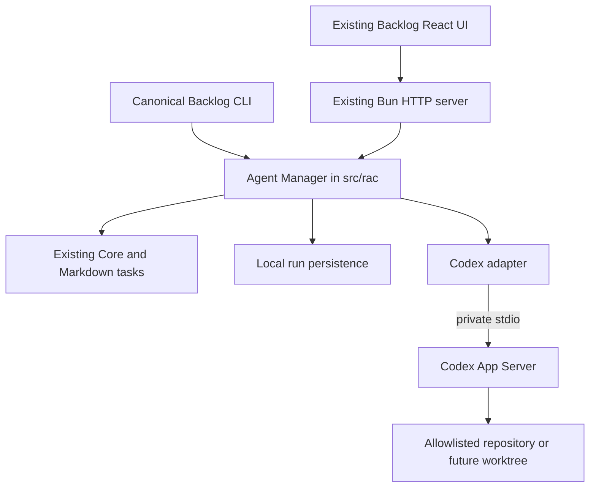

# Remote Agent Control — architecture proposal

Status: researched proposal, 2026-10-24; review in RAC-02 before implementation. Baseline: Backlog.md 1.55.3, commit `6f988de0`, fork `Timorek/Backlog.md`. No RAC runtime or buttons are implemented by this setup.

## Existing architecture and extension points

| Responsibility | Existing files | RAC integration |
| --- | --- | --- |
| Canonical CLI and browser startup | `src/cli.ts` | Future `rac` subcommands invoking the same manager as HTTP. Preserve task commands and allocation. |
| Shared task mutations | `src/core/backlog.ts` | Resolve tasks, enforce identity/read-only rules and apply semantic status/notes updates. Never parse or rewrite task Markdown in the Codex adapter. |
| Task detail, readiness and graph | `src/core/task-detail.ts`, `src/utils/readiness.ts` | Check dependency readiness before accepting a run; preserve graph semantics. |
| Storage, locks and serialization | `src/file-system/operations.ts`, `src/markdown/`, `src/utils/id-generators.ts` | Keep existing Markdown task storage authoritative; do not reuse task IDs for run identities. |
| Reactive corpus | `src/core/content-store.ts`, `src/utils/task-watcher.ts` | Continue publishing task updates through existing watchers. |
| HTTP server | `src/server/index.ts`, `BacklogServer.start` | Register `/api/rac/*` in the current Bun server. Apply authentication and authorization before any protected handler. |
| Frontend and API | `src/web/App.tsx`, `src/web/lib/api.ts` | Reuse routing, API error handling, theme, navigation and current WebSocket task refresh. |
| Task actions and details | `src/web/components/TaskCard.tsx`, `TaskDetailsModal.tsx`, `Board.tsx`, `TaskColumn.tsx` | Put optional Run action and compact run state into existing cards/details; add session contents inside task details. |
| Task relationships | `src/web/components/DependencyGraphSection.tsx`, `DependencyInput.tsx` | Reuse graph and dependency controls, not a second dependency model. |
| Verification | `src/test/`, `src/web/**/*.test.ts` | Extend Bun tests, DOM interaction tests and server endpoint tests; add a narrowly scoped browser flow when runtime starts are possible. |

Backlog runs on **Bun with TypeScript**, not a new Node service. React 19 and React Router power the existing UI; Bun serves the imported HTML entry and Tailwind plugin. Node is a development/build tool. The global Homebrew CLI is 1.55.2 and must not be used to test this 1.55.3 fork.

## Component layout

Proposed future files: `src/rac/manager.ts`, `types.ts`, `store.ts`, `codex-adapter.ts` and a small HTTP registration module if route growth justifies it. Keep process lifecycle, run state and protocol translation cohesive; do not add a provider abstraction or queue framework before a second implementation needs it. Instantiate the manager per resolved project, with shutdown integrated into `BacklogServer.stop`; CLI must use the same semantics. These are proposed files, not present modules.

For MVP, one runner on the same host and one active run per project. Separate run state from task workflow: `queued`, `running`, `waiting_for_input`, `waiting_for_approval`, `interrupting`, `interrupted`, `completed`, `failed`, `unknown` are candidate run states, not new Kanban columns. Successful agent exit alone never marks a task Done. RAC-04 defines transitions after the RAC-03 spike establishes actual events.

## Codex boundary

The official [App Server documentation](https://learn.chatgpt.com/docs/app-server), checked on 2026-10-24, describes bidirectional JSON-RPC over JSONL stdio. Initialize once, acknowledge `initialized`, then use `thread/start` or `thread/resume` and `turn/start`. `turn/steer` addresses active work; `turn/interrupt` ends a turn. Resume means continuing a stored thread, not restoring a suspended OS process.

Questions use `item/tool/requestUserInput`; command/file approvals use their respective `item/*/requestApproval` requests. Preserve the server request ID and thread/turn identity, respond to that request, and reconcile `serverRequest/resolved`. Generate schemas from the installed CLI with `codex app-server generate-ts` / `generate-json-schema`. Protocol availability and model behavior require the RAC-03 spike; installed Codex here is 0.162.1.

Design choices for RAC: spawn a configured executable with an argument array and no shell, keep stdout exclusively for protocol and capture stderr separately. Bound message sizes, queues and timeouts. Do not expose raw JSON-RPC to the browser. Unknown methods fail safely. Questions, permission requests and approval decisions remain distinct; never infer approval from natural language. If a model cannot emit a structured question, end that turn and use a validated new turn in the same thread after a user answer. Do not imply that it was paused. Acknowledging interruption is required before reporting stopped; process termination is a bounded fallback requiring platform-specific validation.

## API and delivery

Reuse current task GET/PUT endpoints (`/api/tasks`, `/api/tasks/:id`) for ordinary task operations. Proposed RAC endpoints from the package:

- `POST /api/rac/runs`: task ID plus configured project identity and idempotency key; no user-supplied executable, arguments or arbitrary cwd.
- `GET /api/rac/tasks/:taskId/runs`, `GET /api/rac/runs/:runId`: run history and state.
- `GET /api/rac/runs/:runId/events?after=<sequence>` and `/stream`: durable history plus proposed SSE delivery with replay.
- `POST /api/rac/runs/:runId/cancel`, `/resume`, `/messages`: explicit lifecycle/chat operations with state validation.
- `GET /api/rac/runs/:runId/interactions`; `POST /api/rac/interactions/:id/answer` or `/decision`: atomic one-time response, scoped to the live run and owner.
- `GET /api/rac/health`: minimal authenticated runner status without sensitive host paths.

Existing task updates already use WebSocket in `App.tsx` and `BacklogServer`; keep that working. In RAC-02 compare extending typed messages on that connection against SSE for ordered, replayable run events. SSE in the package is a proposal, not a reason to run a second server. Persist sequence IDs, deduplicate replay and use cursors with bounded history. A disconnect must not start another agent or resolve a pending interaction.

## Persistence and recovery

Markdown remains the task record. Proposed SQLite via Bun's built-in SQLite stores operational run history, not duplicate task descriptions. Decide the location in RAC-02: an OS data directory keyed by canonical repository identity is preferred to tracked files; handle moved checkouts and worktrees explicitly. If a project-local directory is selected, ignore it before the first write. No database, credentials or full raw logs are committed.

Suggested relations: runs (task, project, provider, thread/turn IDs, lifecycle timestamps, task revision); events (run, monotonic sequence, type, bounded sanitized payload); messages (run, role, item identity); interactions (run, RPC request identity, kind, schema, expiry, resolution); schema migrations. Use transactions/unique constraints for idempotency and interaction resolution. Codex owns its conversation storage; RAC stores mappings and the UI/audit record. On restart reconcile thread state; disconnected runs become unknown until proven otherwise. Persisted request IDs are not evidence that a live process still accepts a reply. Never replay stale approvals automatically.

## Existing UI integration

`TaskCard.tsx` can expose one optional Run action and a state indicator without changing drag behavior. `TaskDetailsModal.tsx` already edits task description, plan, notes, acceptance criteria and relationships. Add a focused run section there, reusing existing modal/focus primitives. Show current session, log stream, messages and pending questions/approvals with explicit command/file scope. Render plain text/sanitized Markdown; bound log rendering and redact secrets server-side. Proposed controls: Run with Codex, Stop Agent, Resume Agent, View Logs, Chat with Agent, Answer Question and Approve / Reject. Enable them from the server state, and preserve a complete human task path when RAC is disabled. No controls are added in this setup.

## Trust and remote access

Current `BacklogServer` binds `127.0.0.1` and has no RAC authorization layer. Keep that boundary. Before internet access, protect the **entire existing dashboard and every mutation endpoint**, including task edits and WebSocket/SSE connections, not just `/api/rac`. An outgoing tunnel plus identity gateway can provide TLS and MFA, but the backend must validate identity/audience/expiry, authorize project/run access, protect cookie-authenticated writes against CSRF, validate Origin and reject unauthenticated upgrades. Restrict any proxy identity headers to a verified trust path. A private network is an alternative, not permission to skip application authorization for an execution API.

Allowlist canonical workspace roots, resolve symlinks, reject path escapes, treat task content and agent output as untrusted, enforce finite concurrency and sandbox policies. Approval display must bind exact run/item/request and granted scope. Record denial, expiry and stale responses. Keep Codex/tunnel/notification tokens in OS/environment secret storage. Notifications carry minimal metadata and links, never command approvals by reply without equivalent authentication. No public exposure or tunnel configuration is performed here.

## Platform and upstream strategy

Development is macOS arm64 in this session. Use portable TypeScript process APIs and absolute paths supplied by configuration; no hard-coded Homebrew paths inside runtime code. Validate cancellation, sandbox behavior, filesystem permissions and symlinks independently on macOS, Linux or Windows before claiming support. launchd is a macOS deployment option (RAC-20); it is not the manager implementation. A LaunchAgent requires login and a sleeping Mac cannot execute work. Future Windows service/task scheduling belongs in deployment-specific configuration after choosing the target host.

Preserve package identity, task schema, routes and current defaults; keep RAC optional, use additive modules, and avoid new dependencies until justified. For an upstream update: start from a clean committed feature branch, `git fetch upstream --no-tags`, review incoming changes, merge `upstream/main`, resolve deliberately, then rerun types/lint/tests and dashboard checks. Do not reset or automatically rebase shared history. Case-insensitive macOS filesystems can collide on upstream tags `V0.3.3` / `v0.3.3`; no-tags fetching avoids importing those tags. Do not delete tags as setup cleanup.

## Review gates

RAC-01 remains active until local dashboard interaction is verified. RAC-02 decides persistence, transport, authentication boundaries and cross-platform scope. RAC-03 validates the installed App Server protocol and genuine question/approval behavior without unlimited permissions. No later RAC task is implemented by this preparation.
