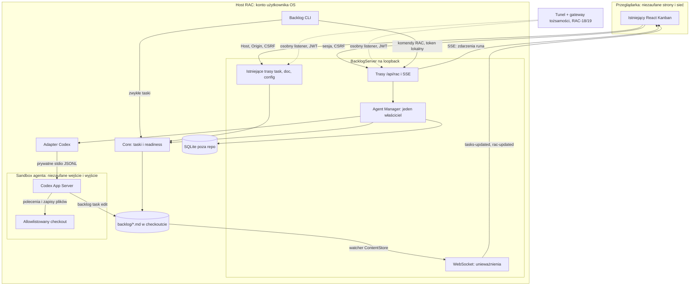

# ADR-0001 — Architektura RAC i granice zaufania

Status: **Accepted — etapowo, zgodnie z decyzją użytkownika Q6**. Data: 2026-10-24; rewizja po review tego samego dnia (sekcja „Historia zmian”).
Task: RAC-02 / BACK-791. Zależność: BACK-790 (Done).

Użytkownik zatwierdził etapowo kierunek D1, D2, D4, D7 i D8 oraz rekomendacje Q1–Q5 i Q7. D3, D5, D6 i D9 są kontraktem wstępnym do sprawdzenia i doprecyzowania w RAC-03; nie są obietnicą zgodności konkretnego modelu/runtime. Wyniki spike zapisujemy w ADR i taskach; materialna zmiana przyjętego kierunku wymaga ponownego przeglądu. BACK-791 może zostać zakończony po zapisaniu decyzji i synchronizacji backlogu, bez rozpoczynania kolejnego taska. Sekcja „Decyzje po review” przechowuje odpowiedzi Q1–Q7, a „Wpływ na taski” ich skutki.

## Kontekst i ograniczenia

Backlog.md 1.55.3 jest aplikacją Bun/TypeScript z React UI. `src/server/index.ts` udostępnia obecne API i HTML na loopback; `src/cli.ts` uruchamia ten sam serwer przez `browser`. Taski i ich semantyka należą do `Core`, Markdown i istniejącego CLI. RAC jest opcjonalnym modułem tej aplikacji. Nie zmieniamy MANIFESTO.md, schematu tasków, domyślnego działania zwykłego Kanbana ani roli CLI jako kompletnego interfejsu kanonicznego.

MVP: jeden użytkownik, jeden jawnie skonfigurowany katalog projektu, jeden lokalny runner Codex i najwyżej jedno aktywne wykonanie. Development odbywa się na macOS; docelowy host nie został wybrany. Port 6421 służy obecnie temu forkowi na Macu użytkownika (6420 zajmuje inny projekt), ale nie stanowi identyfikatora projektu ani stałej protokołu.

Fakty o protokole Codexa pochodzą z [dokumentacji App Server](https://learn.chatgpt.com/docs/app-server) oraz ze schematu wygenerowanego z zainstalowanej wersji 0.162.1 (komendy w sekcji „Dowody”). RAC-03 wykazał różnicę między schematem standardowym a generowanym z `--experimental`: `availableDecisions` występuje w wariancie experimental i w rzeczywistym command approval. Interpretujemy łącznie wersję CLI, wariant schematu i capabilities połączenia; sam schemat standardowy nie opisuje całego przebiegu z experimentalApi=true.

## D1. Wspólny backend i jeden właściciel procesów

Agent Manager będzie wewnętrznym modułem `src/rac/` istniejącego backendu Bun. Proponowany podział odpowiedzialności:

| Moduł | Odpowiedzialność |
| --- | --- |
| `manager.ts` | Walidacja taska/projektu, lifecycle, pojedynczy slot wykonania, interakcje i kontrola procesu. |
| `codex-adapter.ts` | Transport stdio, korelacja RPC, mapowanie zdarzeń i ograniczone zakończenie procesu. |
| `store.ts` | SQLite, transakcje, migracje i odczyty historii; bez drugiego modelu tasków. |
| `types.ts` | Małe wspólne kontrakty Run/Session/Interaction/Event; niezależne od React i DTO Codexa. |
| `http.ts` | Rejestracja tras w `BacklogServer`; walidacja transportu, bez powielania logiki managera. |

Są to przyszłe pliki; nie tworzymy pustych implementacji w RAC-02. Dodatkowe warstwy/provider registry pojawią się dopiero przy realnej potrzebie drugiego providera. Istniejące eksporty TypeScript pozostają wewnętrzną implementacją, a nie publicznym SDK.

**Jeden proces właścicielski na kanoniczny katalog projektu.** Zwykłe procesy CLI nie tworzą własnych managerów. Komendy RAC w CLI są klientami uwierzytelnionego lokalnego API tego samego backendu. Gdy backend nie działa, CLI kończy się czytelną instrukcją uruchomienia `backlog browser --no-open`; bez ukrytego autostartu daemonów. Polecenia zwykłych tasków nadal działają bez serwera. UI i CLI wywołują tę samą walidację lifecycle, więc kliknięcie i polecenie nie konkurują dwoma niezależnymi runnerami.

**Zgodność z manifestem — Q1=A.** Komendy RAC powstają w tych samych taskach co odpowiadające im API: lokalne enable/disable w RAC-05, start/status w RAC-08, cancel/resume/resolve w RAC-10, answer w RAC-14, decide w RAC-16. UI RAC-11 korzysta z już dostarczonych semantyk CLI/API. Zależność komend wykonawczych od jawnie uruchomionego wspólnego backendu nie usuwa kompletnego workflow CLI: serwer uruchamia się kanonicznym poleceniem `backlog browser --no-open`. Zwykłe komendy tasków nadal są lokalne i nie potrzebują serwera. Answer/decide z CLI pozostają warunkowane wykazaną izolacją poświadczeń w RAC-03; brak izolacji blokuje te operacje zamiast udostępniać je agentowi.

**Blokada właściciela.** Właściciel trzyma wyłączną blokadę międzyprocesową w katalogu danych RAC; PID ani zajęty port nie są dowodem tożsamości. Mechanizm wybiera RAC-07:

- rekomendowany: połączenie właściciela z `rac.sqlite` w `PRAGMA locking_mode=EXCLUSIVE` — blokadę zwalnia system przy śmierci procesu, bez heurystyki „stale”; wymaga walidacji uśpienia i Windows. Sama zmiana PRAGMA nie dowodzi ownership: właściciel musi skutecznie uzyskać blokadę przez transakcję zapisu, utrzymywać to samo połączenie i dopiero potem publikować deskryptor. Drugi proces nie otwiera bazy do odczytu historii; odczyty idą przez API właściciela. Szczegóły opisuje [SQLite locking_mode](https://www.sqlite.org/pragma.html#pragma_locking_mode);
- alternatywa: istniejący wzorzec `proper-lockfile`, ale nie z ustawieniami blokad tasków (stale 10 s i domyślny `onCompromised`, który rzuca wyjątek; `src/file-system/operations.ts:260`, `:891`). Po uśpieniu Maca inny proces mógłby uznać blokadę za porzuconą i ją przejąć, a domyślny handler zakończyłby właściciela.

Niezależnie od mechanizmu utrata blokady powoduje odgrodzenie (fencing): manager odmawia nowych zapisów i startów, ale nie kończy procesu awaryjnie. Drugi serwer nie przejmuje ownership automatycznie. Po uzyskaniu blokady właściciel zapisuje uwierzytelniony deskryptor wykrywania (URL loopback, `projectKey`, losowa generacja właściciela), dostępny tylko dla użytkownika systemowego. Backend działa bez RAC, gdy moduł jest wyłączony.

**Druga instancja `backlog browser`.** Dziś drugi proces dla tego samego projektu przechodzi na kolejny wolny port (`src/cli.ts:6086`). Decyzja: druga instancja startuje bez RAC i pokazuje adres instancji-właściciela z deskryptora; zwykły Kanban działa bez zmian.

**Włączanie RAC.** RAC jest domyślnie wyłączony. Włączenie to jawna, lokalna akcja użytkownika zapisująca ustawienia w katalogu danych RAC (D2), poza repozytorium. `backlog/config.yml` ani `PUT /api/config` nie mogą włączyć RAC ani osłabić jego polityk: same ustawienia repozytorium i jego klony nie przyznają uprawnień do wykonywania. Kanoniczny interfejs włączania/wyłączania to lokalne `backlog rac enable` / `backlog rac disable` w RAC-05; nie dodajemy włączania przez niezaufany config repo ani zwykły endpoint edycji ustawień. Domyślnie akcja wymaga lokalnej autoryzacji człowieka; późniejszy jawny wyjątek CLI opisano poniżej. Nie zastępuje to zabezpieczeń interakcji D7.

**Decyzja wykonawcza RAC-05, zaakceptowana przez użytkownika.** Lokalne `enable/disable` na macOS domyślnie wymagają świeżego systemowego uwierzytelnienia przez LocalAuthentication (Touch ID/hasło konta, bez ponownego użycia odblokowania Touch ID). Brak mechanizmu na innym OS, brak narzędzi, anulowanie lub odmowa nie zapisują ustawień. To zgoda na lokalne włączenie modułu, odrębna od aprobat operacji agenta i sesji HTTP. Szczegóły i ograniczenia: [PROJECT-CONFIGURATION.md](../PROJECT-CONFIGURATION.md). Zapis poza checkoutem wymaga nadal ograniczenia agentowi praw zapisu: proces z nieograniczonym dostępem jako ten sam użytkownik OS może modyfikować plik lub zaufany kod.

**Późniejsza zmiana na wyraźne polecenie użytkownika.** `rac enable/disable --skip-system-auth` pomija systemowe uwierzytelnienie. Flaga nie nadaje uprawnień administratora OS, nie jest ustawieniem repo/API i nie omija walidacji root, praw do lokalnych plików ani zabezpieczeń operacji agenta. Proces mający zapis do konfiguracji może jej użyć, także agent z takimi prawami; wcześniejsze bezwarunkowe wymaganie obecności człowieka przy włączeniu zostaje w tym zakresie zastąpione. Domyślne komendy nadal wymagają potwierdzenia. Obsługa ACL Windows pozostaje niewdrożona.

`BacklogServer.stop()` zatrzymuje przyjmowanie nowych komend, rozlicza aktywną turę z ograniczonym czasem oczekiwania, zamyka adapter, unieważnia deskryptor i na końcu zamyka SQLite, zwalniając blokadę. Zerwanie połączenia telefonu nie zatrzymuje agenta. Restart procesu w trybie developerskim (`bun --watch`) jest restartem właściciela, więc aktywna tura kończy się stanem `unknown` (D6); nie obiecujemy jej utrzymania przez HMR.



Linie przerywane to ścieżka zdalna, wyłączona do RAC-18/19. `backlog/*.md` leży w allowlistowanym checkoutcie, więc agent zmienia te same pliki, które czyta Core i obserwuje ContentStore (D9).

## D2. Dane uruchomień poza repo, w SQLite

Wybieramy wbudowane `bun:sqlite`, zamiast nowej usługi Node/ORM lub osobnych plików JSON zapisywanych dla każdego eventu. Bun dokumentuje natywny driver SQLite, transakcje i przygotowane zapytania: [Bun SQLite](https://bun.sh/docs/runtime/sqlite). Zadania pozostają w Markdown; baza przechowuje wyłącznie stan operacyjny oraz historię wykonań.

Domyślne katalogi danych:

| System | Katalog |
| --- | --- |
| macOS | `~/Library/Application Support/Backlog.md/rac/<projectKey>/` |
| Windows | `%LOCALAPPDATA%/Backlog.md/rac/<projectKey>/` |
| Linux | `${XDG_STATE_HOME:-~/.local/state}/backlog-md/rac/<projectKey>/` |

`projectKey` jest SHA-256 kanonicznego absolutnego katalogu projektu (`realpath`); ustawienia lokalne zapisują również ten katalog i sprawdzają zgodność. Klucz nie jest sekretem ani tożsamością użytkownika. Różne worktree mają różne klucze. Po przeniesieniu repo powstaje nowy projectKey i nowa historia (Q7g). Stary katalog danych pozostaje do ręcznego odczytu lub eksportu; MVP nie implementuje relinkowania i nie zgaduje po nazwie folderu ani remote Git. Obsługa Windows wymaga walidacji kanonizacji i wielkości liter na docelowym systemie.

Baza: `rac.sqlite`; blokada, deskryptor właściciela i ustawienia lokalne (w tym włączenie RAC, D1) w tym samym katalogu. Uprawnienia POSIX: katalog 0700, pliki z danymi/poświadczeniami 0600; na Windows równoważna kontrola ACL użytkownika. Nie zapisujemy bazy, logów ani tokenów w Git. Katalog danych musi być lokalnym dyskiem, bez współdzielenia jednej bazy między komputerami czy używania sieciowego filesystemu jako mechanizmu koordynacji.

Migracje RAC-07: numerowane, niezmienne migracje SQL oraz `PRAGMA user_version` podnoszone w tej samej transakcji co każda migracja (Q7e) i inicjalizacja przed przyjmowaniem komend. Tylko właściciel migruje, pod blokadą z D1. Włączone foreign keys, ograniczony busy timeout i WAL. Nieznana nowsza wersja schematu lub nieudana migracja blokuje RAC, nie zwykłe zarządzanie taskami. Nie wykonujemy automatycznych migracji wstecz. Przed zmianą schematu powstaje spójny backup SQLite; kopiowanie samego pliku aktywnej bazy bez WAL nie jest procedurą backupu. Restore wymaga zatrzymanego właściciela i zgodnej wersji aplikacji.

Polityka retencji (Q7c): terminalne runy usuwamy w całości po 30 dniach lub do odzyskania budżetu 100 MiB logicznego payloadu historii projektu; maksymalnie 64 KiB na pojedynczy event. Aktywne runy, `unknown` i ich interakcje są chronione. Nie kasujemy środka strumienia: numeracja zachowanego runa jest ciągła. Dla bieżącego runa limit logów ogranicza nowe delty tekstowe; zapisujemy jeden event `truncated`, rezerwując miejsce na stan, interakcje, wiadomości sterujące i końcowy wynik. Po wyczerpaniu tej rezerwy kontrolowanie przerywamy run; nie kontynuujemy bez audytu. Limit logicznego payloadu nie jest obietnicą rozmiaru SQLite/WAL/backupów; monitorujemy osobno wolne miejsce i ograniczamy kopie. RAC-07/09 dostarczają konfigurację i testy limitów. Awaria zapisu blokuje nowe starty. Eksporty i backupy są prywatnymi artefaktami użytkownika.

## D3. Model Run / Session / Interaction / Event

Kontrakt wstępny do weryfikacji w RAC-03, z przyjętymi uproszczeniami Q7.

| Encja | Kluczowe pola i reguły |
| --- | --- |
| Project | `projectKey`, `canonicalRoot`, `provider`, ograniczone ustawienia lokalne (w tym włączenie RAC). Jeden zarejestrowany root w MVP; klient nie wybiera ścieżki ani projektu. |
| Run | `id`, `projectKey`, `taskId`, `taskCreatedAt`, `taskRevision`, `sessionId`, `status`, `ownerGeneration`, `startedAt`, `finishedAt`, `errorCode`. Jedna próba wykonania taska złożona z jednej lub wielu tur; stan oddzielny od statusu Kanbana. |
| Session | `id`, `projectKey`, `provider`, `threadId`, `currentTurnId`, `protocolVersion`, `createdAt`. Trwałe powiązanie rozmowy (jeden thread), nie proces OS. |
| Interaction | `id`, `runId`, `ownerGeneration`, `rpcRequestId` (z zachowaniem typu), `threadId`, `turnId`, `itemId`, `kind`, `blocking`, ograniczone `schema/options/scope`, `status`, `openedAt`, `expiresAt`, `resolvedAt`, `decision`. `kind`: question / command_approval / file_approval / permission_approval / mcp_elicitation. `status`: open / answered / cleared / expired / uncertain / stale (D5, D6). |
| Event | `runId`, `sequence`, `timestamp`, `kind`, `payloadVersion`, ograniczony oczyszczony payload. Unikalne `(runId, sequence)`, trwały porządek nadawany przez store, nie zegar przeglądarki. |
| Wiadomości | Eventy `user_message` / `agent_message` z `sessionId`, `itemId`, rolą i treścią; bez osobnej tabeli Message (Q7d). Duplikaty po replay i retry nie tworzą nowych wiadomości. |

Run ma obcy klucz do Session; Interaction/Event należą do runa. `taskId` wskazuje task w istniejącym Core, bez foreign key do drugiego magazynu tasków. Ponieważ `task delete` zwalnia ID do ponownego użycia, run zapisuje też `created_date` taska (`taskCreatedAt`); historia pod danym ID pokazuje runy z innym `created_date` jako należące do usuniętego rekordu (minutowa rozdzielczość `created_date` jest akceptowanym ograniczeniem). `taskRevision` to SHA-256 surowej treści pliku taska odczytanej przez Core — `updated_date` ma rozdzielczość minutową i nie nadaje się na rewizję. Ewentualny snapshot prompta jest prywatnym, ograniczonym artefaktem audytu, a nie nową edytowalną specyfikacją. ID runów/sesji mogą być losowe; nie zastępują czytelnych BACK-* ani kluczy RAC-XX.

Przechowywany lifecycle (Q7f): `starting`, `running`, `interrupting`, `interrupted`, `completed`, `failed`, `unknown`, `abandoned` (run `unknown` rozstrzygnięty przez człowieka, D6). `waiting_for_input` / `waiting_for_approval` to wyliczane widoki UI na podstawie zbioru otwartych interakcji **blokujących**, nie osobne przechowywane statusy. Pytanie nieblokujące (`isBlocking: false`) nie oznacza oczekiwania. Jeden run może pokazać wiele rodzajów oczekiwania jednocześnie. Przejścia i priorytet wielu oczekiwań doprecyzuje RAC-04 na podstawie spike RAC-03. Aktywny slot pozostaje zajęty, dopóki run nie jest terminalny (`interrupted`, `completed`, `failed`, `abandoned`); `unknown` nie jest terminalny.

Run a tury: run obejmuje jedną lub więcej tur w swojej Session i kończy się (`completed`), gdy tura kończy się bez otwartej interakcji blokującej i bez pytania w trybie fallback. Wiadomość wysłana podczas aktywnej tury steruje nią (`turn/steer` z `expectedTurnId`); odpowiedź na pytanie fallback uruchamia następną turę w tym samym runie. Wiadomość po zakończeniu runa tworzy nowy run w tej samej Session i zajmuje slot jak każdy start. Resume runa `interrupted` lub `abandoned` także tworzy nowy run w tej samej Session; stary run i jego terminalne zdarzenia pozostają niezmienne. Start z karty taska tworzy nową Session. Wysłanie zwykłej wiadomości nigdy nie rozwiązuje approval.

MVP nie przyjmuje kolejki (Q5=A): przy zajętym slocie `409 run_active`, bez nowego runa ani stanu `queued`. Dopiero RAC-23 wprowadza kolejkę; opis RAC-08 i AC#3 RAC-11 zostają dostosowane do tego kontraktu.

Start ponownie odczytuje jednoznaczny lokalny task i aktualny graf zależności z Core, korzystając z istniejących reguł: `isReadOnlyTask` odrzuca task z innego brancha i z archiwum (`src/types/index.ts:121`), status terminalny odrzuca task zakończony, a readiness traktuje niespełnione i nierozwiązane zależności jako blokujące (`src/utils/readiness.ts`). Niezgodna `expectedTaskRevision` daje `409`. Q3=A: manager nie zmienia statusu ani assignee taska przy starcie. Agent wykonuje te kroki przez istniejący CLI zgodnie z workflow i skonfigurowanymi statusami; pracę widać od razu na odznace runa. Nie kodujemy nazwy „In Progress”. Nie ma wspólnej transakcji między Markdown a SQLite: każdy krok ma wynik audytu; awaria pozostawia stan do uzgodnienia, bez automatycznego nadpisywania późniejszych ręcznych edycji. Sam `completed` agenta nie oznacza Done taska. Q4=A: o terminalnym statusie decyduje człowiek; w MVP ograniczenie agenta do przygotowania raportu jest konwencją promptu z audytem każdej zmiany statusu, a nie twardą izolacją zapisu Markdown.

Implementacja wewnętrznego kontraktu RAC-04: [RUN-STATE.md](../RUN-STATE.md). Dokument zawiera pełną tabelę przejść, obsługę wielu blokujących interakcji i jawne granice czystych funkcji; nie zastępuje testów runtime ani atomowej rezerwacji.

## D4. HTTP jako granica komend, SSE jako kanał zdarzeń

Wybieramy HTTP dla komend i SSE tylko dla zdarzeń RAC. Obecny WebSocket pozostaje kanałem aktualizacji tasków. Odrzucamy dokładanie durable historii RAC do obecnych komunikatów `tasks-updated` bez osobnego kontraktu replay. SSE nie wymaga drugiego serwera; rejestrujemy go w istniejącym `BacklogServer`. Semantykę `text/event-stream`, pola `id` i ponownego łączenia opisuje [MDN EventSource](https://developer.mozilla.org/en-US/docs/Web/API/Server-sent_events/Using_server-sent_events). Żeby karty na tablicy odświeżały odznaki runów (RAC-11), istniejący WebSocket wysyła dodatkowo komunikat `rac-updated` — samo unieważnienie, bez treści i historii; klient pobiera wtedy `GET /api/rac/runs/latest`.

Wspólne wymagania API: wersjonowane DTO `schemaVersion: 1` (jak `--json` w CLI); walidacja typów/limitów; błąd zgodny z istniejącym API — `{ error: "<komunikat>", code: "<kod>" }`, bo `ApiError.fromResponse` (`src/web/lib/api.ts:103`) czyta `error` jako tekst; autoryzacja projektu przed lookup runa/interakcji; brak stack trace/tokenów w odpowiedzi; mutacje przyjmują wyłącznie `Content-Type: application/json` (D7). Klient nie przekazuje executable, argumentów, arbitralnego cwd ani dowolnego RPC. Backend rozwiązuje projekt z konfiguracji właściciela. URL nie jest uprawnieniem dostępu.

| Metoda i ścieżka | Wejście / wynik |
| --- | --- |
| `POST /api/rac/runs` | `{ taskId, expectedTaskRevision }` + `Idempotency-Key`; `202` z runem po zarezerwowaniu startu. |
| `GET /api/rac/runs/latest` | Ostatni run każdego taska i stan slotu — do odznak na tablicy. |
| `GET /api/rac/tasks/:taskId/runs` | Paginowana historia, również po zmianie/archiwizacji taska, oraz aktualna `taskRevision`; brak skutków ubocznych. |
| `GET /api/rac/runs/:runId` | Snapshot stanu i najwyższa sekwencja eventu. |
| `GET /api/rac/runs/:runId/events?after=N&limit=L` | Uporządkowana strona historii, `nextAfter`, `hasMore`. |
| `GET /api/rac/runs/:runId/stream` | SSE; `id` to sekwencja w tym runie, wspólny envelope z historią. |
| `POST /api/rac/runs/:runId/cancel` | Idempotentne żądanie przerwania; potwierdzenie przyjęcia nie oznacza zakończenia procesu. |
| `POST /api/rac/runs/:runId/resume` | Klucz idempotencji; nowy run w istniejącej Session, ponowna kontrola taska/uprawnień i slotu. |
| `POST /api/rac/runs/:runId/resolve` | Tylko dla `unknown`: człowiek potwierdza, że poprzedni proces nie działa (UI pokazuje diagnostykę, np. PID jako wskazówkę) → `abandoned`, slot wolny. Nigdy wywoływane automatycznie. |
| `POST /api/rac/runs/:runId/messages` | `{ text, expectedTurnId } + `Idempotency-Key``; deduplikacja; steer aktywnej tury albo nowy run w tej samej Session (D3). |
| `GET /api/rac/runs/:runId/interactions` | Lista oczekujących pytań/zgód z zakresem i opcjami, bez surowych możliwości RPC. |
| `POST /api/rac/interactions/:id/answer` | `{ answers } + `Idempotency-Key``; odpowiedzi zgodne ze schematem pytania. |
| `POST /api/rac/interactions/:id/decision` | `{ decision } + `Idempotency-Key``; tylko decyzje z allowlisty MVP (D5). |
| `GET /api/rac/health` | Minimalny stan managera, store, wersji i zajętego slotu; bez poufnych ścieżek. |

Dla wszystkich mutacji RAC unikalność `(projectKey, operation, resourceId, Idempotency-Key)`, zapis hasha wejścia i pierwotnego wyniku w jednej transakcji z rezerwacją. Ten sam klucz i to samo wejście zwracają wcześniejszy wynik; zmienione wejście daje `409 idempotency_conflict`. Nie wolno wygenerować nowego klucza w automatycznym retry. Obecny `ApiClient.fetchWithRetry` (`src/web/lib/api.ts:156`) ponawia błędy sieci, 5xx i timeouty (10 s, do 3 powtórzeń); nowe komendy muszą używać stabilnych identyfikatorów albo istniejącej ścieżki bez retry. Jeden nagłówek `Idempotency-Key` i jedna tabela obejmują także wiadomości, odpowiedzi, decyzje i cancel (Q7a). Identyfikator `clientUserMessageId` dla Codexa jest wyprowadzany ze stabilnej tożsamości tej samej mutacji; nie wymaga drugiego identyfikatora od klienta. Backend sam sprawdza generację interakcji i odrzuca `stale`; klient nie przesyła `expectedOwnerGeneration` (Q7b). Deduplikacja obowiązuje również CLI.

SSE jest autoryzowane i tylko do odczytu. `Last-Event-ID` ma pierwszeństwo przed początkowym `after`; wartość musi być poprawną sekwencją tego runa. Snapshot zawiera `lastSequence`, klient otwiera stream od tego punktu i deduplikuje po `(runId, sequence)`. Backend buforuje nowe eventy podczas replay i przełącza na live bez luki; trwały zapis poprzedza publikację. Retencja kasuje wyłącznie całe terminalne runy, więc zachowany run nie ma luk ani komunikatu `history_reset` (Q7c). Usunięty run daje `410 history_expired` przed otwarciem SSE; UI odświeża listę historii. Przekroczenie limitu logów sygnalizuje trwały event `truncated`, bez usuwania wcześniejszych sekwencji. Heartbeat nie konsumuje numerów. Wolny klient ma ograniczony bufor, potem reconnect, a nie blokowanie procesu agenta. Reconnect nie uruchamia nowego runa.

Przykładowe błędy: 400 niepoprawne wejście, 401 brak sesji, 403 niedozwolony Host/Origin/CSRF/projekt, 404 zasób niewidoczny w uprawnionym projekcie, 409 konflikt rewizji/stanu/slotu/idempotencji, 410 wygasła interakcja, 413 zbyt duży payload, 415 niedozwolony `Content-Type`, 429 limit żądań, 503 store/provider niedostępny. Nie retryujemy odrzuconej zgody ani nie zamieniamy timeoutu w sukces.

## D5. Adapter Codex, pytania i zgody

Część protokołu potwierdzona w RAC-03; niewykazane przypadki i ograniczenia zestawiono w sekcji dowodów spike.

Oficjalny [Codex App Server](https://learn.chatgpt.com/docs/app-server) opisuje dwukierunkowy JSON-RPC przez stdio JSONL, handshake `initialize` / `initialized`, operacje thread/turn, żądania pytań i zgód oraz `serverRequest/resolved`. Schematy można wygenerować z konkretnej wersji CLI. `turn/interrupt` dotyczy tury; kontynuacja rozmowy korzysta z thread, nie z przywrócenia procesu OS.

Decyzje RAC: wyłącznie prywatne stdio; stdout to protokół, stderr to ograniczony log. Wersja Codexa z audytu: 0.162.1. Dopasowanie metod, pól i capabilities do tej wersji, dostępność pytań w rzeczywistym trybie/modelu oraz zachowanie po przerwaniu weryfikuje RAC-03. Nie kopiujemy bez testów aktualnego przykładu web jako gwarancji zgodności z lokalną wersją.

Fakty ze schematu 0.162.1 i ich konsekwencje:

| Obszar | Stan w 0.162.1 | Konsekwencja dla RAC |
| --- | --- | --- |
| Transport | Domyślnie `stdio://`; także `unix://`, `ws://IP:PORT` (wg dokumentacji listener poza loopbackiem domyślnie bez uwierzytelnienia) oraz `app-server daemon` z przełącznikiem remote control. | Adapter uruchamia proces z jawnym `--listen stdio://`. Nie używa daemona, socketu ani `ws://`. Politykę wobec remote control na hoście RAC ustalają RAC-03 i RAC-19 (D7). |
| Pytania | `item/tool/requestUserInput` z wymaganym polem `isBlocking`. | Pytanie nieblokujące nie wstrzymuje runa (D3). |
| Zgody | `item/commandExecution/requestApproval`, `item/fileChange/requestApproval`, `item/permissions/requestApproval`; starsze `applyPatchApproval` i `execCommandApproval`. | Mapowanie na `command_approval`, `file_approval`, `permission_approval`. Starsze metody dostają błąd JSON-RPC. |
| Decyzje | `accept`, `acceptForSession`, `acceptWithExecpolicyAmendment`, `applyNetworkPolicyAmendment`, `decline`, `cancel`. `availableDecisions` jest pominięte w standardowym schemacie, ale obecne w schemacie experimental i zaobserwowane w runtime (RAC-03). | MVP oferuje wyłącznie jednorazowe `accept`, `decline` i `cancel`, z przecięcia własnej allowlisty per typ z `availableDecisions`, gdy runtime je poda. Brak tego pola nie jest zgodą na szersze opcje. Decyzji poszerzających uprawnienia, `grantRoot` w zgodzie na pliki ani przyznania uprawnień z `permissions` nie oferujemy. |
| Recenzent zgód | `approvalsReviewer`: `user`, `auto_review`, `guardian_subagent`; globalny config może włączyć automatyczną recenzję. | Zawsze jawnie `user` (D7). |
| Inne żądania serwera | `mcpServer/elicitation/request`, `item/tool/call`, `account/chatgptAuthTokens/refresh`, `attestation/generate`. | Elicitation to `mcp_elicitation` (rekomendacja dla MVP: odrzucenie; potwierdza RAC-03). Pozostałe i każda nieznana metoda: natychmiastowa odpowiedź błędem JSON-RPC i event audytu, bo brak odpowiedzi zawiesza turę. |
| Rozwiązanie żądania | `serverRequest/resolved` z `threadId` i `requestId`, emitowane także przy sprzątaniu przez providera (start, koniec lub przerwanie tury). | `resolved` bez wysłanej przez RAC odpowiedzi oznacza `cleared`, nie `answered`. |
| Sterowanie turą | `turn/steer` wymaga `expectedTurnId`; `turn/start` i `turn/steer` przyjmują `clientUserMessageId`. | Zgodne z D4. |

Adapter wysyła wyłącznie allowlistowane metody: `initialize`, `initialized`, `thread/start`, `thread/resume`, `turn/start`, `turn/steer`, `turn/interrupt` oraz odpowiedzi na żądania serwera. Nigdy `command/exec`, `fs/*`, `thread/shellCommand`, zapisów konfiguracji ani innych metod wykonawczych.

Każde żądanie oczekujące jest korelowane z runem, generacją właściciela, thread/turn/item i oryginalnym request ID (z zachowaniem jego typu). Zanim UI może odpowiedzieć, Interaction i event oczekiwania trafiają do store. Backend weryfikuje zakres i przyjmuje pierwszą poprawną odpowiedź atomowo. Rozróżniamy przyjęcie odpowiedzi, wysłanie do providera oraz potwierdzenie rozwiązania; bez obietnicy exactly-once przez granicę procesu. Jeśli proces zniknie między wysłaniem a potwierdzeniem, interakcja dostaje status `uncertain` i jest uzgadniana, a zgoda nie jest wysyłana ponownie.

Zgody na całą sesję, trwałe reguły wykonywania i szersze uprawnienia nie są opcją MVP. Wygaśnięcie, brak odpowiedzi i nieznana metoda nie oznaczają akceptacji. Pytania biznesowe są odrębne od command/file/permission approvals. Gdy structured question nie jest dostępne, fallback wymaga zweryfikowanego formatu pytania i nowej tury w tej samej sesji; nie rozpoznajemy approval z dowolnego tekstu agenta. RAC-03 potwierdził dwie tury fallbacku na gpt-6.1-sol, natomiast native requestUserInput nie został zaobserwowany. MVP korzysta z potwierdzonego fallbacku; ścieżkę natywną włączamy po jej odrębnej weryfikacji w wybranym profilu. Domyślna `approvalPolicy` to `on-request` (Q4=A), z `approvalsReviewer: user`; nigdy `never`. Nie twierdzimy, że to wymusza akceptację każdej lokalnej edycji taska.

Wygaśnięcie interakcji (propozycja: konfigurowalne, domyślnie 60 min; ustalają RAC-04 i RAC-13): dla żądania blokującego RAC wysyła `turn/interrupt`, provider czyści żądania (`serverRequest/resolved`), interakcja dostaje `expired`, a run `interrupted` — wznawialny przez resume, ze zwolnionym slotem. Dla pytania fallback (tura już zakończona) run przechodzi w `interrupted`.

## D6. Odzyskiwanie i izolacja awarii

RAC-03 potwierdził EOF procesu i interrupt aktywnej tury. Cleanup potomków, przerwanie z pending requestem i resume po awarii pozostają wymaganymi testami RAC-06/10.

Po restarcie nieterminalne runy poprzedniego właściciela przechodzą do `unknown`, a ich interakcje do `stale` — bez automatycznego wysłania odpowiedzi. Slot pozostaje zajęty, dopóki człowiek nie rozstrzygnie losu poprzedniego procesu przez `resolve` (D4; w CLI zależnie od Q1). Żyjący, nierozpoznany proces nie uprawnia do startu drugiego. PID jest wskazówką diagnostyczną, nigdy samodzielną podstawą zabicia procesu. Generacja, identyfikator sesji i świadectwo własności ograniczają ryzyko PID reuse. Ten sam scenariusz dotyczy restartu `bun --watch` w developmencie i restartu przez launchd (RAC-20) — to koszt przyjęty w MVP; alternatywę opisuje sekcja „Alternatywy i koszty”.

Przerwanie: żądanie, oczekiwanie na wynik tury, ograniczony deadline i udokumentowana eskalacja procesu należącego do managera. RAC-06 sprawdza, czy app-server kończy się po zamknięciu stdin (śmierć backendu) i czy manager pod Bun kończy całą grupę procesów potomnych; walidacja na macOS i Windows w RAC-06/10. Nie zakładamy przenośności sygnałów Unix. Brak dowodu zatrzymania oznacza `unknown`, nie `interrupted`. Nie wznawiamy automatycznie po reboocie, wybudzeniu Maca ani restarcie backendu. Awaria store blokuje mutacje wykonawcze; dostęp do zwykłych tasków pozostaje użyteczny.

## D7. Granice zaufania i skutki uruchamiania na komputerze

Taski, pliki repozytorium, komentarze, zależności i output agenta są wejściem nieufnym. Prompt injection może namawiać do odczytania kluczy, wysłania danych, zmiany zakresu lub uruchomienia poleceń. Instrukcja w promptcie nie jest granicą bezpieczeństwa. Agent działa z uprawnieniami procesu i dodatkowymi ograniczeniami sandboxa; lokalne wykonanie może modyfikować projekt, uruchamiać złośliwe skrypty zależności i korzystać z dostępnej sieci/poświadczeń. Allowlista cwd sama nie izoluje filesystemu. Pliki sterujące agentem w workspace (`AGENTS.md`, `.codex/`, `.claude/`, `backlog/`) są niezaufane, a agent może je zmienić między runami — prompt injection może więc przetrwać do następnego runa.

| Granica | Wymagana kontrola |
| --- | --- |
| Przeglądarka → API | Host wyłącznie `127.0.0.1:<port>` lub `localhost:<port>` (ochrona przed DNS rebinding); Origin serwera dla mutacji przeglądarkowych/RAC, upgrade WebSocket i otwarcia SSE; mutacje RAC tylko z `Content-Type: application/json`, istniejące API zachowuje zgodne formaty treści; sesja i CSRF dla mutacji opartych na cookie; limity wejścia i żądań; obce strony nie dostają CORS. |
| Ciasteczka | Cookie nie izolują portów: ciasteczko z `127.0.0.1:6421` trafia także na `127.0.0.1:6420` i do innych lokalnych aplikacji, które mogą je nadpisać. Nazwa cookie zawiera `projectKey`, a sesja po stronie serwera jest związana z `projectKey` i generacją właściciela; HttpOnly i odpowiednia polityka SameSite, Secure przy dostępie zdalnym. |
| CLI → właściciel | Losowy lokalny sekret z pliku prywatnego dla użytkownika, weryfikacja projectKey i generacji; sekret poza argv, URL i logami. Poświadczenie pozwalające rozstrzygać interakcje musi być nieosiągalne z sandboxa agenta (niżej). |
| Backend → provider | Stała skonfigurowana binarka, lista argumentów bez shell, jawne `--listen stdio://`, ograniczone cwd/env/uprawnienia, brak root/admin i `danger-full-access`. Przy każdym `thread/start`, `thread/resume` i `turn/start` RAC jawnie ustawia polityki: `sandbox` w thread/start i thread/resume, a `sandboxPolicy` w turn/start, wraz z `approvalPolicy` i `approvalsReviewer: "user"`. Efektywne wartości porównuje z `ThreadStartResponse` / `ThreadResumeResponse`; słabsze oznaczają odmowę startu. `TurnStartResponse` w 0.162.1 zawiera wyłącznie `turn`, więc nie udajemy potwierdzenia polityk z tej odpowiedzi. RAC-03 ustala sprawdzalną weryfikację na poziomie tury; brak dowodu nie pozwala osłabić polityki. |
| Provider → komputer | Sandbox z write tylko do dozwolonego projektu; minimalna sieć i środowisko, brak zbędnych tokenów/tunelu w env procesu. Brak działającego sandboxa blokuje start. |
| Provider → UI | Ograniczone oczyszczone dane, brak wykonywania ANSI/HTML/poleceń z logów, redakcja sekretów przed zapisem i transmisją. |
| Dysk → odzyskanie | Prywatne dane i blokada, poprawna wersja bazy, żadnych automatycznych powtórek zaległych approvals. |

**Agent nie może rozstrzygać własnych zgód.** Agent działa jako ten sam użytkownik OS i sam korzysta z CLI Backloga (D9). Jeśli sandbox czyta poza workspace (np. katalog danych RAC z sekretem CLI) i dostanie sieć do loopback — choćby przez zatwierdzoną zgodę na `npm install` albo `item/permissions/requestApproval` — proces uruchomiony przez agenta, także w tle, mógłby wywołać `/interactions/:id/decision`. Wymaganie: poświadczenie do odpowiedzi i decyzji jest nieosiągalne z sandboxa (np. tylko sesja przeglądarki albo sekret w magazynie systemowym niedostępnym z sandboxa), a koniec runa kończy całą grupę procesów agenta. RAC-03 wykazał odczyt syntetycznego pliku poza workspace i odmowę połączenia loopback w natywnym profilu :workspace. Nie jest to dowód izolacji właściwego sekretu RAC ani zachowania po rozszerzeniu sieci; warunek blokujący answer/decide pozostaje obowiązujący.

**Lokalna ochrona wszystkich tras przed pierwszym endpointem wykonawczym (RAC-08).** Obecny serwer nie sprawdza Host ani Origin (brak takich kontroli w całym `src/`), handlery POST parsują `req.json()` bez sprawdzenia Content-Type (np. `src/server/index.ts:982`), a upgrade WebSocket nie sprawdza Origin (`src/server/index.ts:717`). Obca strona może więc już dziś utworzyć lub zmienić task — prostym POST bez preflightu (CSRF) albo przez DNS rebinding. Z RAC powstaje łańcuch: wstrzyknięta treść taska → kliknięcie Run → wykonanie przez agenta. Dlatego kontrola Host/Origin/Content-Type obejmuje wszystkie trasy od RAC-08, nie dopiero od RAC-18. Natywne `routes` Bun obsługują żądania przed fallback `fetch` (`src/server/index.ts:408`, `:538`), więc wrapper wyłącznie wokół `handleRequest` nie jest globalną ochroną; implementacja wymaga wspólnej polityki na wszystkich drogach wejścia i testów bezpośrednich żądań. RAC-08 wymaga też jawnie ustanowionej sesji użytkownika lub tokenu lokalnego, autoryzacji i CSRF dla mutacji opartych na cookie. Pętla lokalna nie zastępuje autoryzacji i nie chroni przed innym procesem działającym jako ten sam użytkownik. Ochrona przed całkowicie przejętym kontem OS jest poza zakresem aplikacji. Redakcja logów ogranicza ryzyko, ale nie gwarantuje usunięcia każdego sekretu; uprawnienia magazynu i minimalizacja zapisywanej treści pozostają wymagane. Polityki zarządzane Codexa nie mogą być osłabiane przez parametry z UI ani przez pliki w workspace. Lokalne parowanie/cookie nie może opierać się na sekrecie w query string; sposób bezpiecznego ustanowienia sesji należy do implementacji wspólnej polityki auth, nie do prompta agenta.

Dostęp z internetu jest wyłączony do RAC-18/19 i testów negatywnych. Tunel (np. cloudflared) łączy się z 127.0.0.1, więc po adresie IP nie da się odróżnić ruchu zdalnego od lokalnego, a nagłówek Host można zmienić w konfiguracji tunelu. Rekomendacja: tunel kieruje na osobny listener loopback, na którym każde żądanie wymaga ważnego JWT gatewaya tożsamości (podpis, `iss`, `aud`, `exp`), albo jednolite uwierzytelnienie każdego żądania na wspólnym listenerze; nigdy wnioskowanie „lokalny” z IP lub Host. Gateway z MFA nie zastępuje walidacji w backendzie. Zabezpieczone muszą być wszystkie istniejące task/doc/settings/init/assets API i trasy HTML oraz WebSocket i SSE, nie tylko `/api/rac`; trybu developerskiego (`NODE_ENV=development`) nie wystawiamy zdalnie.

Nie ufamy niezweryfikowanym nagłówkom reverse proxy. Sekrety gateway, Codexa i powiadomień pozostają w bezpiecznej konfiguracji użytkownika/OS. Ochrona CSRF obejmuje także mutacje, a sesję/Origin weryfikujemy przy upgrade WebSocket i otwarciu streamu. UI pokazuje zakres każdej zgody, a backend sprawdza, czy nadal odpowiada otwartej prośbie. Nigdy nie wystawiamy publicznie stdio/RPC providera ani ogólnego API wykonywania poleceń. Własne kanały zdalne Codexa (daemon, remote control, `ws://`) są osobną ścieżką wykonania: na hoście RAC muszą być wyłączone albo osobno ocenione (RAC-19). Powiadomienia (RAC-25) niosą minimalne metadane i link; odpowiedź na powiadomienie nigdy nie rozstrzyga zgody bez równoważnego uwierzytelnienia.

**Uzupełnienie wykonawcze RAC-08 (2026-10-25):** użytkownik zaakceptował jednorazowe
parowanie: `rac pair` wydaje krótki kod, wymieniany w lokalnym dashboardzie na sesję
projektu. Kod wygasa po 2 minutach i 5 próbach; sesja wygasa po 8 godzinach lub
restarcie właściciela. CLI start/status używa prywatnego deskryptora i nagłówków;
mutacje sesji cookie wymagają CSRF. Nie wymaga to hasła konta przy każdym starcie.
To nie jest izolacja poświadczeń decyzji ani autoryzacja dostępu z internetu.
Szczegóły, dowody i ograniczenia: [LOCAL-API.md](../LOCAL-API.md).

**Korekta po review PR #1:** Origin pozostaje obowiązkowy dla przeglądarkowych
mutacji oraz wszystkich mutacji RAC i połączeń WS/SSE. Zwykłe lokalne klienty bez
metadanych przeglądarki/cookie zachowują dotychczasową obsługę API. Bezpieczna
nawigacja GET do dokumentu z obcej witryny jest dozwolona. Pusty POST zwykłego API
nie wymaga Content-Type; istniejący tekstowy edytor decyzji zachowuje swój format.
RAC nadal wymaga JSON, uwierzytelnienia i CSRF dla cookie. Potwierdzone sprzątnięcie
własnej grupy procesów oznacza interrupted; brak dowodu pozostawia unknown.
BACK-818 dostarcza wcześniej planowane dla RAC-10 ludzkie CLI/API resolve, bez
cancel/resume i bez automatycznego zabijania lub ponawiania procesów.


## D8. Host developerski, docelowy runner i granica przyszłej rozbudowy

macOS jest środowiskiem developmentu i pierwszych lokalnych testów. Docelowy runner może działać na macOS albo Windows dopiero po wyborze hosta i walidacji. W MVP backend, SQLite i Codex działają na jednym hoście; nie wysyłamy cwd Maca na inny komputer. Na Windows trzeba przetestować ścieżki/ACL, uruchomienie binarki, sandbox, zarządzanie drzewem procesów, SQLite i mechanizm usługi. Dopóki te testy nie przejdą, dokumentujemy Windows jako projektowaną możliwość, a nie wspierane wdrożenie.

launchd należy do wariantu macOS w RAC-20, a Windows service/Task Scheduler do przyszłego wariantu deploymentu. LaunchAgent działa po zalogowaniu; uśpiony Mac nie wykonuje zadania. Status offline/unknown ma być widoczny bez fałszywej obietnicy działania przez całą dobę.

Granica przyszłego rozdzielenia hosta to komendy `start`, `interrupt`, `sendMessage`, `answer`, `decide`, `readState` i uporządkowane eventy z managera, z identyfikatorami projektu/run/session. W MVP jest to wywołanie modułu, nie wdrożona sieciowa usługa ani nowy framework. Gdy powstanie zdalny runner, jego lokalna konfiguracja mapuje projectKey na własny allowlistowany root. Potrzebne będą osobne uwierzytelnienie hostów, szyfrowanie transportu, fencing właściciela, heartbeat/timeout i audyt; nie wystarczy przenieść istniejący spawn za HTTP.

## D9. Agent jako użytkownik Backloga

Przyjęty kierunek Q2–Q4; RAC-03 potwierdził fallback pytania. Twarda izolacja poświadczeń i implementacja bramki planu nadal wymagają odrębnych dowodów w taskach runtime.

Agent pracujący w checkoutcie jest pełnoprawnym użytkownikiem Backloga: zgodnie z AGENTS.md i `backlog instructions task-execution` przez CLI przypisuje task, zmienia status, zapisuje plan, notatki i kryteria, a według `task-finalization` może ustawić status terminalny. To zgodne z zasadą „jeden model dla ludzi i agentów”, ale RAC musi określić kontrakt runa:

- **Wejście runa.** RAC przekazuje treść taska odczytaną przez Core w chwili startu (zgodną z `taskRevision`), polecenie pracy według workflow Backloga i przyjęte reguły Q2–Q4 (pytania strukturalne, granice z D7).
- **Przegląd planu przed wykonaniem — Q2=A.** Agent przygotowuje i zapisuje plan przez CLI, po czym prosi o akceptację pytaniem strukturalnym. Wykonuje implementację dopiero po odpowiedzi. Nie dodajemy pól akceptacji planu do taska. RAC-08 uruchamia początkowo wyłącznie fazę planowania; do dostarczenia interakcji RAC-13/14 backend nie udostępnia przejścia do wykonania. Dzięki temu nie tworzymy cyklicznej zależności tasków RAC-08 ↔ RAC-13, a wczesny endpoint nie omija przeglądu planu. Końcowy przepływ weryfikuje RAC-17.
- **Status i assignee przy starcie — Q3=A.** Zmienia je agent przez istniejący CLI, nie manager.
- **Status terminalny.** Przy `approvalPolicy: on-request` i sandboxie `workspace-write` polecenie `backlog task edit` w workspace zwykle nie wymaga zgody, więc reguła „Done tylko decyzją użytkownika” (RAC-24 AC#3) jest wtedy konwencją promptu; wymuszenie wymaga polityki zgód albo wykrywania zmiany (Q4=A; użytkownik świadomie przyjął konwencję i audyt zamiast twardego wymuszenia; RAC-03 potwierdza rzeczywiste zachowanie).
- **Współbieżne edycje.** Zapis taska chroni blokada per task, która nie czeka (`withTaskLock`, `src/file-system/operations.ts:801`): przy konflikcie edycja człowieka lub agenta kończy się błędem zamiast scalania. Przy Q3=A manager nie zapisuje statusu taska. Agent raportuje konflikt blokady i ponownie odczytuje task przed ewentualną nową próbą, bez ukrytego nadpisywania edycji człowieka.
- **Ślad zmian.** Raport runa (RAC-24) wyróżnia zmiany plików sterujących agentem (D7) i zmiany statusu taska wykonane w trakcie runa.

## Zakres MVP i świadomie odroczone funkcje

MVP po realizacji odpowiednich tasków obejmuje jeden projekt/użytkownika/providera, start/interrupt/resume, stan i trwałe logi, chat, pytania i approvals w obecnym Kanbanie. Dostęp przez telefon/internet jest osobnym etapem RAC-18–21 po lokalnym przepływie end-to-end, nie warunkiem uruchamiania zwykłego Backlog.md. To jest docelowy zakres po kilku taskach; RAC-02 dostarcza wyłącznie projekt.

Poza MVP: wiele repozytoriów/użytkowników, publiczny execution endpoint, równoległe agenty i kolejka (RAC-23), worktree per run (RAC-22), drugi provider (RAC-26), powiadomienia Telegram (RAC-25), zdalny runner na osobnym hoście, automatyczne merge/push/release, pełna zgodność mobilna z desktopem i gwarancja pracy śpiącego hosta. Bez worktree agent pisze w aktualnym checkout; użytkownik musi widzieć ten zakres, a RAC odmawia startu przy trwającej innej operacji Git lub nieustalonym poprzednim wykonaniu. Współbieżna ręczna edycja nie jest izolowana przez jeden slot managera. Z worktree (RAC-22) agent zmienia branchową kopię `backlog/tasks`, a dashboard czyta główny checkout — RAC-22 musi określić, jak zmiany tasków wracają, zgodnie z semantyką cross-branch Backloga.

## Alternatywy i koszty

| Alternatywa | Powód odrzucenia / koszt wybranej decyzji |
| --- | --- |
| Osobny Node backend i dashboard | Dubluje produkt i walidację; łamie założenie integralnego rozszerzenia. In-process manager zwiększa znaczenie shutdown i limitów zasobów Bun. |
| Manager uruchamiany oddzielnie przez każde CLI | Umożliwia podwójne wykonania i sprzeczne sesje. Wybrany właściciel wymaga działającego lokalnego backendu dla komend RAC. |
| JSON/Markdown na każdy event | Nadal potrzebne locking, transakcje, indeksy i retencja. SQLite wymaga migracji i prywatnych backupów poza Git. |
| Wszystko przez obecny WebSocket | Wymaga nowego trwałego protokołu replay i mieszania z bieżącymi odświeżeniami tablicy. SSE dodaje drugi typ połączenia do tego samego serwera, ale oddziela historię runa od invalidation tasków. |
| Auth dopiero po tunelu | Naraża lokalny execution endpoint wcześniej. Podstawowa ochrona wszystkich tras jest bramką RAC-08; pełny audyt całego UI/API poprzedza publikację. |
| Automatyczne wznowienie po awarii | Ryzyko powielenia poleceń i starych zgód. unknown + jawne odzyskiwanie wymaga działania użytkownika, ale zachowuje kontrolę. |
| Daemon lub unix socket Codexa (`codex app-server daemon`, `--listen unix://`) | Mógłby utrzymać turę przez restart backendu, także `bun --watch`. Koszt: drugi długo żyjący proces z własnym cyklem życia, aktualizacjami i przełącznikiem remote control. Do oceny w RAC-03; w MVP prywatne stdio. |
| Blokada właściciela przez `proper-lockfile` z ustawieniami tasków | Heurystyka „stale” po mtime: po uśpieniu Maca możliwe przejęcie blokady i zakończenie właściciela przez domyślny `onCompromised`. Rekomendowany SQLite EXCLUSIVE (D1) wymaga walidacji na Windows. |

## Decyzje po review

Użytkownik odpowiedział na pytania w tej sesji: Q6 — „Akceptacja etapowa — zgodnie z rekomendacją review”; Q1–Q5 i Q7 — „Przyjmuję cały rekomendowany pakiet”. Warianty poniżej zachowujemy jako ślad przeglądu; obowiązują zapisane odpowiedzi, a nie odrzucone alternatywy. „Potrzebne przed” wskazuje task, którego kontrakt dostosowano do decyzji. Szczegóły zależne od rzeczywistego Codexa nadal weryfikuje RAC-03.

### Q1. Zakres CLI dla RAC

Konflikt z MANIFESTO.md i AGENTS.md opisany w D1.

- **A (rekomendowana):** komendy RAC w CLI w tych samych taskach co API: start, status, cancel i resolve w RAC-08/10; answer i decide w RAC-14/16. RAC-11 zależy od komend z RAC-08.
- **B:** osobny task „RAC CLI” przed RAC-11.
- **C:** świadomy wyjątek — MVP zaczyna od UI, CLI później; wymaga zatwierdzenia odstępstwa od AGENTS.md.

Niezależnie od wariantu: czy answer i decide są dostępne z CLI, zależy od wyniku RAC-03 dotyczącego izolacji poświadczeń (D7). Q1 obejmuje też interfejs włączania RAC (D1).

Potrzebne przed: RAC-05 (włączanie) i RAC-08. Odpowiedź: **A — przyjęta przez użytkownika 2026-10-24**.

### Q2. Przegląd planu przed wykonaniem

Pętla z manifestu (plan → przegląd → wykonanie) i krok 7 `task-execution` wymagają akceptacji planu przy decyzjach materialnych; pierwotny opis RAC-08 nie uwzględniał tej bramki. Przyjęta odpowiedź A jest już wpisana w D9 i w wymagania tasków.

- **A (rekomendowana):** run zaczyna się fazą planu — agent zapisuje plan przez CLI i prosi o akceptację pytaniem strukturalnym (RAC-13); wykonanie po odpowiedzi. Bez nowych pól taska.
- **B:** start tylko dla tasków z jawnie zaakceptowanym planem — wymaga nowego znacznika akceptacji w tasku.
- **C:** bez bramki — wystarcza potwierdzenie startu w RAC-11.

Potrzebne przed: RAC-08 i RAC-13. Odpowiedź: **A — przyjęta przez użytkownika 2026-10-24**.

### Q3. Status i assignee przy starcie runa

- **A (rekomendowana):** RAC nie zmienia taska; agent robi to zgodnie z workflow (krok 3 `task-execution`), a pracę widać z odznaki runa. Jeden model dla ludzi i agentów, bez zakodowanej nazwy statusu.
- **B (wersja pierwotna ADR):** RAC przez Core ustawia skonfigurowany status aktywny przed startem adaptera; assignee bez zmian.
- **C:** jak B, a dodatkowo RAC dopisuje tożsamość agenta jako assignee.

Potrzebne przed: RAC-08. Odpowiedź: **A — przyjęta przez użytkownika 2026-10-24**.

### Q4. Kto może zakończyć task i domyślna polityka zgód

Pierwotne RAC-24 AC#3 deklarowało brak Done bez decyzji użytkownika, choć agent może sam zmienić status terminalny (D9). Po odpowiedzi A kryterium doprecyzowano: manager nie finalizuje taska; reguła agenta jest konwencją promptu i jest audytowana, bez gwarancji twardej blokady zapisu.

- **A (rekomendowana dla MVP):** konwencja w prompcie — agent nie ustawia statusu terminalnego; raport RAC wyróżnia każdą zmianę statusu w trakcie runa; `approvalPolicy: on-request`.
- **B:** `approvalPolicy: untrusted` — każde niezaufane polecenie, także `backlog task edit -s Done`, wymaga zgody. Najbezpieczniejsze, ale uciążliwe; RAC-03 mierzy liczbę próśb.
- **C:** agent może finalizować według workflow Backloga — sprzeczne z RAC-24 AC#3, wymaga zmiany tego AC.

Potrzebne przed: RAC-08 i RAC-16. Odpowiedź: **A — przyjęta przez użytkownika 2026-10-24**.

### Q5. Kolejka czy `409` w MVP

- **A (rekomendowana, wersja ADR):** `409 run_active`, kolejka dopiero w RAC-23; wymaga zmiany opisu RAC-08 i AC#3 RAC-11.
- **B:** stan `queued` już w MVP — część RAC-23 przechodzi do RAC-08.

Potrzebne przed: RAC-04. Odpowiedź: **A — przyjęta przez użytkownika 2026-10-24**.

### Q6. Tryb akceptacji ADR

RAC-03 zależy od RAC-02, więc BACK-791 nie może być Done przed akceptacją.

- **A (rekomendowana):** akceptacja etapowa — D1, D2, D4, D7 i D8 teraz; D3, D5, D6 i D9 jako wstępne, poprawiane po RAC-03.
- **B:** akceptacja całości teraz.
- **C:** akceptacja dopiero po wynikach RAC-03 — wymaga zmiany zależności RAC-03 od RAC-02.

Potrzebne przed: zamknięciem BACK-791 i startem RAC-03. Odpowiedź: **A — przyjęta przez użytkownika 2026-10-24**.

### Q7. Uproszczenia mechanizmów

Przyjęte uproszczenia zastępują mechanizmy z pierwotnego ADR. D2–D4 opisują już wariant docelowy:

| # | Mechanizm przed uproszczeniem | Przyjęte uproszczenie |
| --- | --- | --- |
| a | `Idempotency-Key`, `responseId`, `clientMessageId` | Jeden nagłówek `Idempotency-Key` dla wszystkich mutacji RAC i jedna tabela. |
| b | `expectedOwnerGeneration` w żądaniach | Serwer sam odrzuca interakcje poprzedniej generacji (`stale`, D6). |
| c | Sygnał `history_reset` w SSE | Retencja całymi runami terminalnymi i limit na run z jednym eventem `truncated`; sekwencje runa bez dziur. |
| d | Osobna encja Message | Wiadomości jako eventy `user_message` / `agent_message` z deduplikacją. |
| e | Tabela `schema_migrations` | `PRAGMA user_version` zmieniane w transakcji migracji. |
| f | `waiting_for_input` / `waiting_for_approval` jako statusy runa | Przechowywany tylko cykl życia; oczekiwanie wyliczane z otwartych interakcji blokujących. |
| g | Jawne ponowne powiązanie historii po przeniesieniu repo | Nowa historia; stary katalog danych do ręcznego odczytu. |

Rekomendacja: przyjąć wszystkie. Potrzebne przed: RAC-04 (f), RAC-07 (a, c, d, e, g) i RAC-14 (a, b). Odpowiedź: **wszystkie uproszczenia a–g przyjęte przez użytkownika 2026-10-24**.

## Wpływ na taski

Po akceptacji etapowej i odpowiedziach Q1–Q7 aktualizujemy poniższe taski przez CLI. Zmienia się dokumentacja wymagań; żaden z przyszłych tasków nie jest tym samym rozpoczęty ani ukończony. Podstawową ochronę lokalną włączamy do RAC-08 przed handlerem wykonania, bez nowego taska i bez zmiany liczby 28 zadań RAC.

| Task | Wymagana zmiana | Zależy od |
| --- | --- | --- |
| RAC-03 / BACK-792 | Dodać weryfikację: zasięg odczytu i sieci sandboxa (katalog danych RAC, loopback); efektywne `approvalsReviewer`, `approvalPolicy` i `sandbox`; `isBlocking`; pozostałe żądania serwera; `serverRequest/resolved` po przerwaniu; zamknięcie app-server po EOF stdin; daemon i remote control; różnicę schematu standard/experimental dla `availableDecisions`. | Q6 |
| RAC-04 / BACK-793 | Lista stanów według D3: lifecycle bez `queued`, `interrupted` zamiast `cancelled`, `abandoned`; oczekiwanie wyliczane z interakcji blokujących, bez osobnych statusów w bazie. | Q5, Q7 |
| RAC-05 / BACK-794 | Zamiast „nieznany projectId”: wiązanie sesji i żądań z `projectKey`; bez abstrakcji wielu projektów w MVP; lokalne włączanie RAC poza repo. | Q1 |
| RAC-06 / BACK-795 | Runtime Bun zamiast „Node.js”; jawne `--listen stdio://`; allowlista metod wychodzących; natychmiastowy błąd na nieobsługiwane żądania; zakończenie grupy procesów. | — |
| RAC-07 / BACK-796 | Blokada właściciela z fencingiem (D1); `taskCreatedAt` i `taskRevision` w runie; retencja całymi runami, eventy wiadomości i PRAGMA user_version według Q7. | Q7 |
| RAC-08 / BACK-797 | Bez `queued`; nowe AC: ochrona Host/Origin/Content-Type wszystkich tras i sesja związana z `projectKey` przed wykonaniem; wspólna idempotencja; faza planowania bez implementacji przed akceptacją (D9); komendy CLI start/status. | Q1–Q5 |
| RAC-09 / BACK-798 | `rac-updated` na WebSockecie; replay zgodnie z Q7c. | Q7 |
| RAC-10 / BACK-799 | Akcja `resolve` dla `unknown`; wygaśnięcie interakcji przez `turn/interrupt`. | Q1 |
| RAC-11 / BACK-800 | AC#3 bez `queued`; odznaki z `GET /api/rac/runs/latest` i `rac-updated`. | Q1, Q5 |
| RAC-13 / BACK-802 | `isBlocking`, `mcp_elicitation`, statusy `cleared`/`uncertain`/`stale`, błąd JSON-RPC na pozostałe żądania. | — |
| RAC-14 / BACK-803 | Odrzucanie interakcji poprzedniej generacji; mechanizm idempotencji według Q7. | Q7 |
| RAC-15 / BACK-804 | Pytanie nieblokujące widoczne bez stanu oczekiwania. | — |
| RAC-16 / BACK-805 | AC#3: allowlista MVP (`accept`, `decline`, `cancel`) dla typu żądania, zawężana przez `availableDecisions`, gdy runtime je poda; `approvalsReviewer: "user"`. | Q4 |
| RAC-18 / BACK-807 | Osobny listener tunelu z walidacją JWT albo jednolite uwierzytelnienie; ciasteczka związane z `projectKey`. | — |
| RAC-19 / BACK-808 | Kanały zdalne Codexa (daemon, remote control, `ws://`) wyłączone albo ocenione. | — |
| RAC-20 / BACK-809 | Restart przez launchd kończy aktywny run jako `unknown` (czeka na `resolve`); healthcheck to pokazuje. | — |
| RAC-22 / BACK-811 | Przepływ zmian tasków między worktree a głównym checkoutem. | — |
| RAC-24 / BACK-813 | Raport wyróżnia zmiany plików sterujących agentem i statusu taska w trakcie runa. | Q4 |
| RAC-25 / BACK-814 | Odpowiedź na powiadomienie nie rozstrzyga zgody. | — |
| RAC-27 / BACK-816 | Testy: próba rozstrzygnięcia zgody z sandboxa, obcy Host/Origin i `text/plain` na istniejących trasach, kolizja ciasteczek dwóch projektów. | — |
| Nowe taski | Nie tworzymy: CLI jest w odpowiadających taskach API (Q1=A), a lokalna ochrona tras/sesji jest obowiązkowym warunkiem RAC-08. | Q1 |

## Weryfikacja i następne punkty przeglądu

RAC-03 sprawdza rzeczywisty Codex i schematy (lista w „Wpływ na taski”); RAC-04 definiuje testowalne przejścia. RAC-05/06/07 realizują allowlistę, lifecycle i storage. RAC-08 musi zweryfikować ochronę wszystkich tras, ownership, idempotencję i auth przed startem procesu. RAC-09 testuje replay bez luk, limity i retencję. RAC-13–16 testują konkurujące interakcje, wygasanie i odmowę zgody. RAC-18/19/21 warunkują dostęp zdalny. Sam ADR nie dowodzi działania tych funkcji.

Minimalne przyszłe testy: dwa klienty startujące jednocześnie, drugi właściciel i utrata blokady (także po uśpieniu), druga instancja `browser` bez RAC, niejednoznaczny lub blokowany task, timeout między RPC i zapisem, dwie odpowiedzi na approval, restart przed i po wysłaniu odpowiedzi, `resolve` runa `unknown`, błędny Host/Origin, CSRF i `text/plain` na istniejących trasach, kolizja ciasteczek dwóch projektów, próba rozstrzygnięcia zgody z sandboxa, odmowa startu przy słabszej efektywnej polityce Codexa, nieobsługiwane żądanie serwera, przerwanie tury z otwartym żądaniem (`cleared`), wyciek treści do logów, symlink poza root, brak miejsca i błąd migracji, SSE replay podczas nowych eventów, zakończenie drzewa procesów na każdym wspieranym systemie. Testy UI obejmą istniejący task modal i kartę, bez osobnego Kanbana.

### Pokrycie kryteriów RAC-02

| AC | Miejsce w ADR |
| --- | --- |
| 1. Komponenty i przepływ danych | D1, diagram z granicami zaufania. |
| 2. API i Run/Session/Interaction/Event | D3–D5, D9. |
| 3. Lokalizacja danych i migracje | D2, D6. |
| 4. Prompt injection i skutki uruchomienia na PC | D7, D9, zakres zapisu w checkout w sekcji MVP. |
| 5. Poza MVP | Zakres MVP i odroczone funkcje. |
| 6. Development vs host, macOS/Windows | D8. |

### Dowody

Fakty o kodzie i protokole można odtworzyć bez uruchamiania modelu:

```bash
codex --version                       # codex-cli 0.162.1
codex app-server --help               # transporty stdio/unix/ws, daemon, proxy
codex app-server generate-json-schema --out <katalog>
# metody: ServerRequest.json, ClientRequest.json, ServerNotification.json
# pola:   v2/ThreadStartParams.json, v2/ThreadStartResponse.json,
#         ToolRequestUserInputParams.json, CommandExecutionRequestApprovalParams.json
grep -rniE 'get\("(origin|host|sec-fetch-site)"\)' src --include='*.ts'   # brak w kodzie produkcyjnym
grep -n 'req.json()' src/server/index.ts
```

Odwołania do kodu: `src/server/index.ts:408`, `:538`, `:717`, `:982`; `src/web/lib/api.ts:103`, `:156`; `src/file-system/operations.ts:260`, `:801`, `:891`; `src/cli.ts:6086`; `src/types/index.ts:121`; `src/utils/readiness.ts`. Rozdzielczość dat taska widać we frontmatterze (`updated_date: '…T09:31:00Z'`).

Dokument opracowano na podstawie kodu forka, dokumentacji źródłowej i schematu wygenerowanego z zainstalowanego Codexa, odczytanych 2026-10-24. Projektowane polityki i kontrakty RAC są rekomendacją autora ADR, nie obietnicą istniejącego Backlog.md ani gwarancją providera. Wyniki kontroli dokumentu (Biome, typy, testy, Mermaid) są zapisane w notatkach BACK-791.

## RAC-03 — dowody spike i ograniczenia

Zapis szczegółowy: [RAC-03 — Codex App Server spike](../spikes/RAC-03-CODEX-APP-SERVER.md), z oczyszczonymi wynikami i 148 wpisami rzeczywistego przebiegu z Terminala użytkownika. Model gpt-6.1-sol wykonał pięć tur: cztery zakończone oraz jedną przerwaną. Potwierdzono initialize, efektywne ograniczone polityki thread/start, command approval z odmową i serverRequest/resolved, brak pliku poza workspace, interrupt oraz EOF z exit 0 bez eskalacji.

Nie zaobserwowano native requestUserInput. Dwie zakończone tury w tym samym thread potwierdzają fallback: ograniczone pytanie JSON i odpowiedź. Resume tej próby zwróciło -32600; nie ustalono, czy przyczyną był tryb ephemeral, nie badano persistent resume po crashu. Osobna próba natywnego sandboxa :workspace potwierdziła odczyt syntetycznego pliku poza workspace i blokadę loopback (errno 1); nie odczytywano prawdziwych poświadczeń. Uprawnienia pliku poza checkoutem nie są same dowodem izolacji sekretu dla procesu tego samego użytkownika. CLI answer/decide pozostaje zablokowane do wykazania tej izolacji w implementacji.

Korekta wcześniejszego wniosku: availableDecisions istnieje w schemacie 0.162.1 wygenerowanym z --experimental oraz w obserwowanym runtime z experimentalApi=true; jest pominięte tylko w schemacie standardowym. Własna allowlista jest zawężana przez listę providera, jeśli ta została przesłana. SandboxPolicy nadal nie zawiera readOnlyAccess/access również w wariancie experimental — nie wysyłamy nieobsługiwanych pól i nie zakładamy ograniczenia odczytu na podstawie writableRoots.

Ograniczona sesja agenta nie uruchamia providera (EPERM przed initialize); zachowano te nieudane próby oddzielnie od udanych prób użytkownika. Nadal niewykazane: pytania nieblokujące, przerwanie z pending approval, cleanup całego drzewa procesów, resume trwałej sesji po awarii, izolacja właściwych poświadczeń i Windows. Same nazwy zdarzeń remoteControl/status/changed nie dowodzą stanu zdalnego sterowania; audyt hosta pozostaje bramką RAC-19. Task badawczy może zostać zakończony z tymi jawnymi ograniczeniami; nie oznacza to wdrożenia ani zatwierdzenia nieprzetestowanego recovery.

## Historia zmian

- 2026-10-24 — wersja pierwotna (@codex).
- 2026-10-24 — rewizja po review (@claude):
  - dodano D9, „Otwarte decyzje” (Q1–Q7), „Wpływ na taski”, tabelę faktów protokołu 0.162.1 i diagram z granicami zaufania;
  - D1: konflikt CLI z manifestem (Q1), fencing blokady i rekomendacja SQLite EXCLUSIVE, jedno zachowanie drugiej instancji `browser`, lokalne włączanie RAC poza repo;
  - D3: `taskCreatedAt` i definicja `taskRevision`, stan `abandoned`, statusy interakcji, `mcp_elicitation`, pytania nieblokujące, semantyka run/tura; zmiana statusu przy starcie przeniesiona do Q3;
  - D4: endpointy `resolve` i `runs/latest`, unieważnienie `rac-updated`, format błędu zgodny z istniejącym API, wymóg `application/json`;
  - D5: allowlista metod wychodzących i decyzji MVP, odpowiedź błędem na nieobsługiwane żądania, statusy `cleared` i `uncertain`, wygaśnięcie przez `turn/interrupt`;
  - D6: rozstrzyganie `unknown` przez człowieka, restart w developmencie i przez launchd;
  - D7: ochrona wszystkich tras od RAC-08, ciasteczka a porty, agent bez dostępu do decyzji, jawne ustawienia i weryfikacja polityk Codexa, osobny listener tunelu, kanały zdalne Codexa, pliki sterujące agentem, powiadomienia;
  - wyniki kontroli dokumentu przeniesiono do notatek BACK-791, gdzie były już zapisane.

- 2026-10-24 — zastosowanie review i decyzji użytkownika (@codex): przyjęto Q1–Q5=A, Q6=A (etapowo), Q7=a–g; zsynchronizowano wymagania przyszłych tasków przez CLI bez rozpoczynania ich implementacji. Zweryfikowano schemat Codex 0.162.1 lokalnie; doprecyzowano sandboxPolicy/odpowiedzi thread vs turn. Test SQLite potwierdził konieczność realnego uzyskania blokady, nie samego ustawienia PRAGMA. Zachowano wcześniejsze poprawki recenzenta.

- 2026-10-24 — RAC-03 (@codex): dodano odtwarzalny probe stdio i natywnego sandboxa oraz link do dowodów; oddzielono schemat/fixtures od nieudanego startu rzeczywistego providera. Zaznaczono brak weryfikacji modelu i izolacji, bez zmiany zaakceptowanych decyzji.

- 2026-10-24 — wyniki Terminala użytkownika w RAC-03: model gpt-6.1-sol, poprawny fallback/odmowa/interrupt/EOF; odczyt canary poza workspace i blokada loopback w natywnym sandboxie. Skorygowano availableDecisions: pole experimental obecne również w runtime. Zachowano ograniczenia oraz bramkę izolacji poświadczeń CLI.
